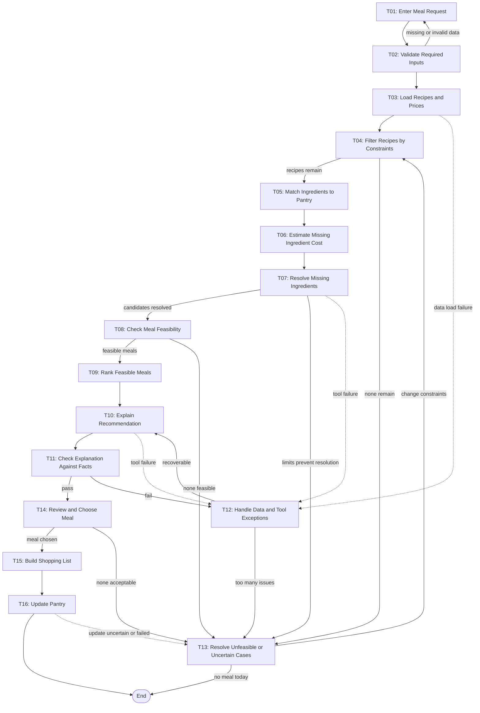

# Workflow of Tasks

## 1. Workflow Goal

This workflow supports the goal in our completed team charter.

"Using the ingredients a student has, their preferences, available time, and budget, the agent will find meals they can feasibly make, show what they already have and what is missing, and explain how the gaps affect the choice. Every ingredient and figure the agent reports is backed by the student's pantry data or the local recipe and price files. The system aims to help the student decide what to eat quickly, and will produce a shopping list for any missing items."

## 2. Workflow Trigger

The student submits their pantry items, preferences, allergies, equipment, time available, budget for missing ingredients, and servings.

## 3. Completion Condition at Runtime

The student has chosen a meal, received a shopping list for any missing items, and had the pantry updated if they cooked it. The run also ends if the student decides on no meal today.

## 4. General Workflow

T01: Enter Meal Request
Student enters pantry items, preferences, allergies, equipment, time, budget, and servings.

T02: Validate Required Inputs
Checks for missing or invalid fields. Invalid input returns to T01.

T03: Load Recipes and Prices
Loads the local recipe library, price list, and substitution table.

T04: Filter Recipes by Constraints
Removes recipes that break allergy, diet, equipment, or time rules. If none remain, goes to T13.

T05: Match Ingredients to Pantry
Compares each remaining recipe's ingredients, scaled to servings, with the pantry: have, partial, or missing.

T06: Estimate Missing Ingredient Cost
Estimates the cost of each recipe's missing ingredients from the price list.

T07: Resolve Missing Ingredients
The agent chooses how to resolve missing ingredients: check pantry equivalents, suggest a substitution, widen the recipe search, or test a small budget margin. It may skip or repeat these, and hands off to T13 when limits prevent resolution.

T08: Check Meal Feasibility
Checks each candidate against allergies, diet, ingredients, cost, time, and expiry. If none pass, goes to T13.

T09: Rank Feasible Meals
Ranks feasible meals with the weighted formula in the README.

T10: Explain Recommendation
Writes what the student has, what is missing, what it costs, and how substitutions change the dish, using only computed facts.

T11: Check Explanation Against Facts
Checks that every statement in the explanation matches the pantry and computed values. Failures go to T12.

T12: Handle Data and Tool Exceptions
Reviews failures. A few fixable mismatches return to T10; everything else goes to T13.

T13: Resolve Unfeasible or Uncertain Cases
Student decides whether to change a constraint or end with no meal.

T14: Review and Choose Meal
Student chooses a meal or says none is acceptable.

T15: Build Shopping List
Builds the shopping list of missing items with estimated cost.

T16: Update Pantry
After the student confirms they cooked, subtracts the used ingredients from the pantry file.

Any automated task that fails routes to T12. A failed pantry update (T16) goes to T13 so the student can check the pantry.

## 5. Workflow Diagram

